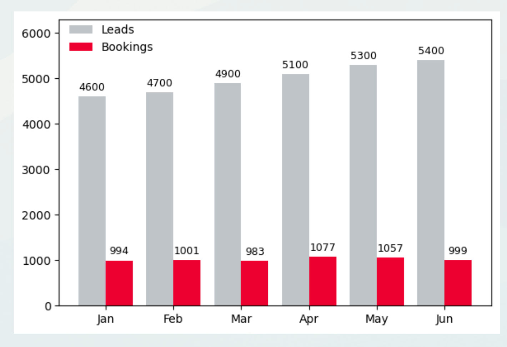
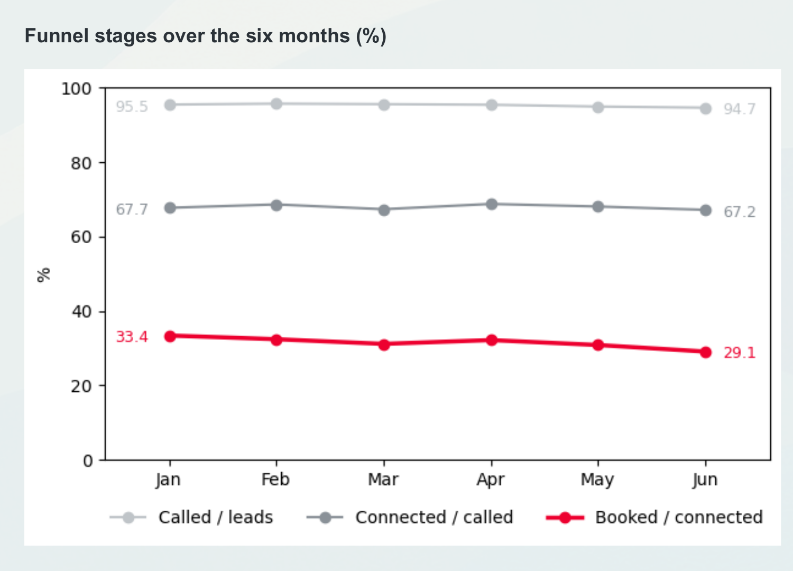
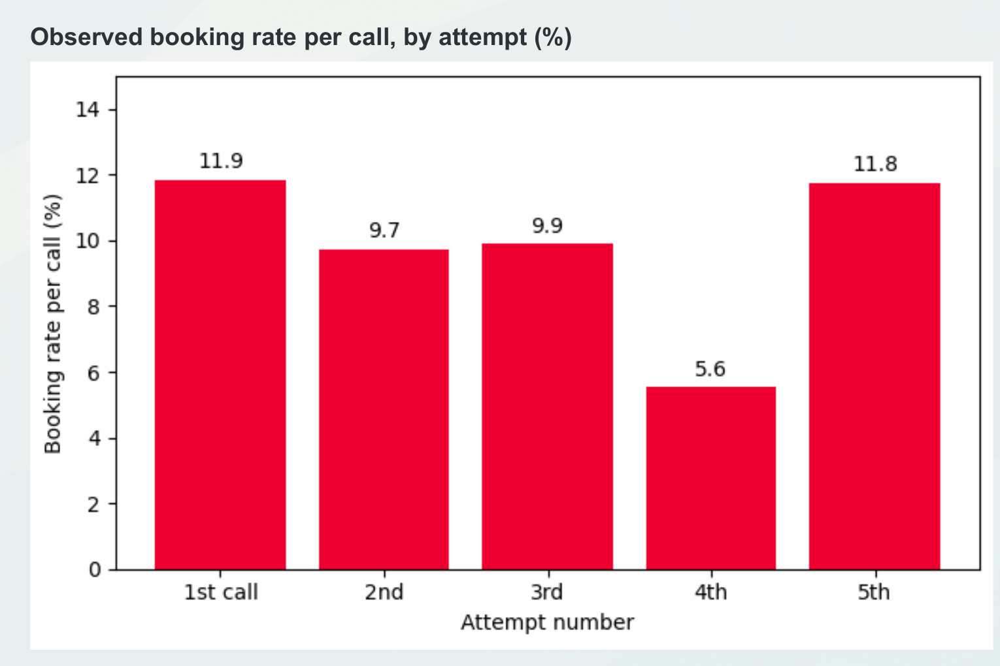

# Customer Acquisition Funnel Analysis

A marketing performance case study using six months of synthetic acquisition and outbound data. I used Python and DuckDB/SQL to understand why growing lead volume and spend were not translating into more bookings, then traced the problem through the funnel and turned the findings into practical recommendations.

**Tools:** Python, DuckDB / SQL, pandas, matplotlib, Excel  
**Scope:** 30,000 leads, 57k+ outbound calls, 6,111 booked visits  
**Focus:** funnel analysis, KPI analysis, data quality, lead treatment, commercial recommendations

[View the analysis notebook](analysis/funnel_analysis.ipynb) · [View the case presentation](reports/customer_acquisition_funnel_analysis.pdf)

## The business question

Lead generation was increasing, but bookings were not keeping pace. The question was where performance was deteriorating and what could realistically be improved without materially increasing acquisition spend.

The process is:

`Lead → Called → Connected → Visit booked`

I looked at the problem from both sides: commercial performance across months and channels, and how leads were being treated by the outbound team.

## What I found

Across the six-month period, **30,000 leads** entered the funnel. **28,591** were called at least once, **19,431** connected with an agent and **6,111** booked a visit. Overall lead-to-booking conversion was **20.4%**.



Lead volume increased from **4,600 in January to 5,400 in June**, while bookings were almost unchanged at **994 versus 999**. Cost per lead also moved very little, from roughly **EUR 58 to EUR 60**, so the deterioration in cost per booking was mainly associated with weaker conversion rather than more expensive leads.

### The main loss happened after connection

I checked whether the January-to-June conversion decline could be explained by incomplete follow-up time or a change in channel mix. Restricting June to leads with a full 13-day conversion window left conversion at 18.6% versus 18.5% overall, and reweighting the channel mix to January did not materially change the result.

The funnel breakdown was more informative:



- Call coverage stayed around **95%**.
- Connection rate stayed around **67%**.
- Bookings per connected lead fell from **33.4% to 29.1%**.
- Roughly **90% of the overall conversion decline** sits in that final stage.

That shifted the diagnosis away from "we need more leads" and towards what happens after an agent actually reaches somebody.

### Later calls still produced bookings

A simple comparison by total number of calls is misleading because the outcome affects the number of attempts: once a lead books, calls stop. I therefore also looked at the observed booking rate of each individual call.



The first and fifth recorded calls both had observed booking rates of about **12%**. This does **not** mean that adding a fifth call would causally produce the same result; leads that reached later attempts were selected to continue.

The more actionable pattern was where unbooked leads stopped:

- **21,617** unbooked leads stopped before a fifth attempt.
- **8,730** stopped after only one call.
- **2,386** were last recorded as **"Follow-up required"** and received no further call.
- When a lead marked "Follow-up required" did receive another call, that next call booked **16.0%** of the time, compared with **8.4%** after "No answer".
- **1,409 leads** received no call at all.

These are observational patterns rather than causal estimates, but they give clear groups to prioritise in an operational test.

## Recommendations

**1. Test one more attempt for leads asking for follow-up.**  
Start with the 2,386 unbooked leads whose final recorded outcome was "Follow-up required". Measure incremental bookings per 100 extra calls and per hour of agent time.

**2. Make outbound prioritisation more explicit when capacity is tight.**  
Attempts per lead were similar across channels even though booking performance differed. I would test a queue based first on the previous call outcome and then on channel, rather than assuming the same treatment is appropriate for every lead.

**3. Investigate why paid-for leads are never called.**  
The data cannot tell whether the 1,409 never-called leads are the result of capacity limits, routing rules or a deliberate process decision. That is an operational question worth resolving before increasing acquisition volume.

**4. Test media changes rather than immediately moving budget.**  
Some channels look better on cost per booking, but the dataset uses synthetic/randomised cost information and stops at the booked visit. I would test changes in a limited setting and extend measurement to visit attendance, customer conversion, contract value and retention before making a larger allocation decision.

## Data quality and analytical checks

I spent part of the analysis checking the structure before calculating KPIs. The main issue was the outbound table, which contained **180 exact duplicate rows**. Twenty-three of those duplicated records carried a booking flag. After removing the duplicate rows, the outbound booking flags matched the **6,111** records in the prospects table.

I also checked keys, missing values, timestamp order and joins between the tables. A few fields were redundant in this synthetic dataset: `Campaign_Name` corresponds to attempt number, and `Connected_Flag` contains the same connection information as `Contact_Outcome`.

## Important limitations

This was originally completed as a recruitment analytics exercise using **synthetic data**, so the figures should not be interpreted as real company performance.

The analysis is observational. Later-attempt booking rates describe the leads that were actually called again; they do not estimate what would happen if every stopped lead received another attempt. The dataset also ends at the booked visit, so it contains no information on attendance, customer conversion, contract value, retention or lifetime value. Agent capacity and cost are also missing, which means I cannot calculate whether additional calls would ultimately be profitable.

The source documentation also states that acquisition costs and contact timing were randomised. For that reason, I treat channel cost comparisons as diagnostic and do not use time-to-first-contact as a performance conclusion.

## Repository structure

```text
customer-acquisition-funnel-analysis/
├── README.md
├── analysis/
│   └── funnel_analysis.ipynb
├── data/
│   ├── marketing_performance_case.xlsx
│   └── README.md
├── visuals/
│   ├── leads_vs_bookings.png
│   ├── funnel_stage_trends.png
│   └── booking_rate_by_attempt.png
├── reports/
│   └── customer_acquisition_funnel_analysis.pdf
├── requirements.txt
└── .gitignore
```

## Reproducing the analysis

1. Clone or download the repository.
2. Create a Python environment and install the packages in `requirements.txt`.
3. Open `analysis/funnel_analysis.ipynb`.
4. Run the notebook from top to bottom.

The notebook expects the workbook at `data/marketing_performance_case.xlsx`.

## Why I included this project

This project is less about building a complex model and more about **analytical diagnosis**: checking messy data, choosing the right funnel denominator, challenging an initially tempting interpretation, using SQL to trace where performance changed, and separating useful operational signals from claims the data cannot support.
